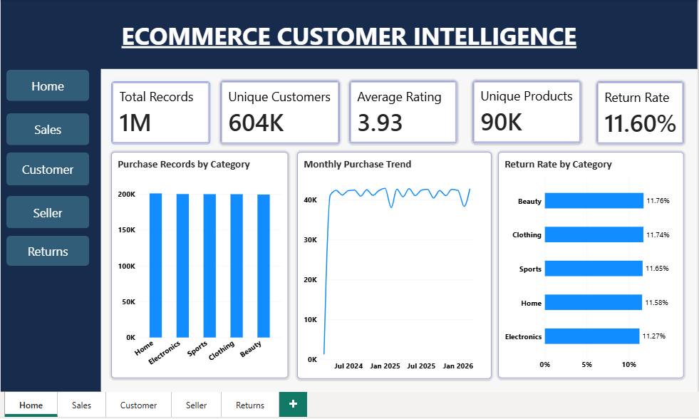
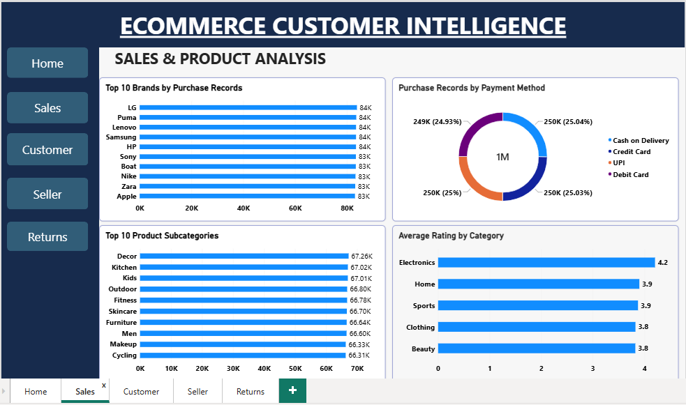
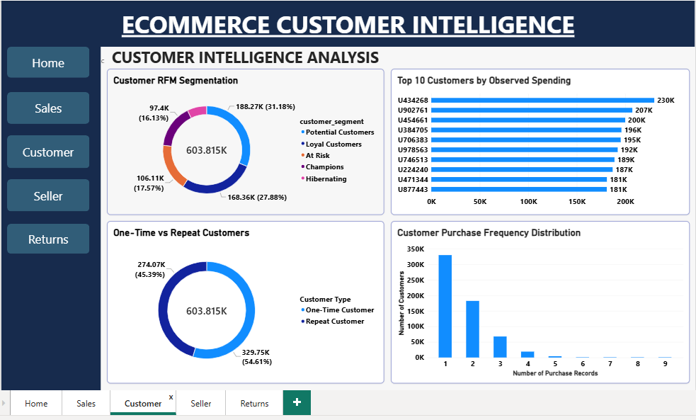
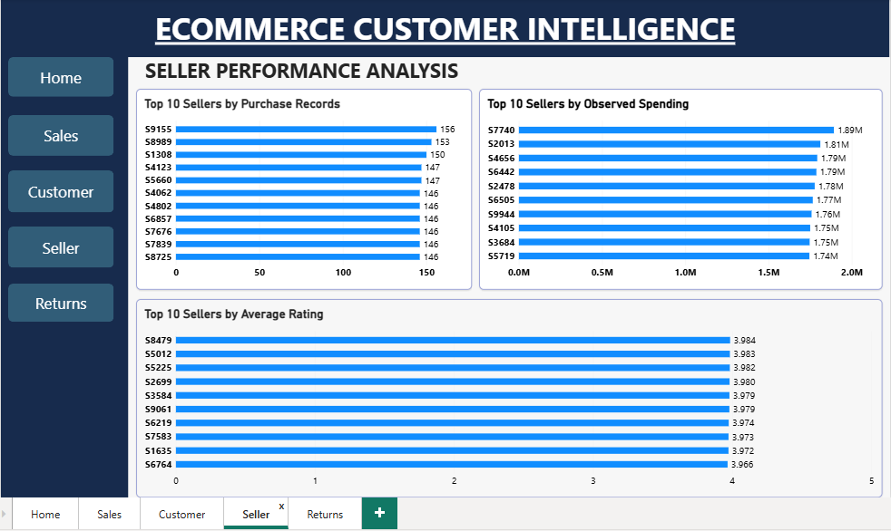
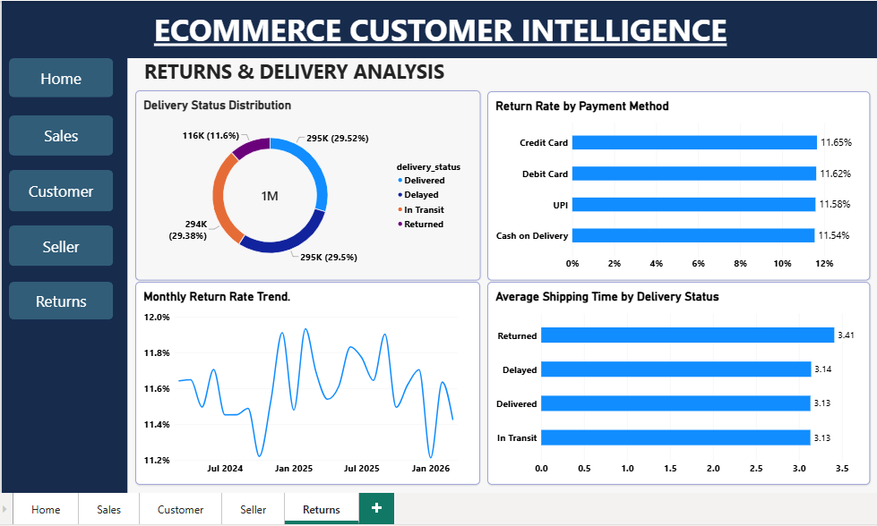

# Ecommerce Customer Intelligence

End-to-end customer analytics on a 1M-row Amazon-style ecommerce dataset
(Kaggle) using Python, MySQL and Power BI.

## Project Overview

Analyzes 1 million purchase records to understand customer behavior,
product and seller performance, returns and delivery patterns.

## Tools & Technologies

Python (Pandas, NumPy, Matplotlib) · MySQL 8 · Power BI · DAX · Git & GitHub

## Key Features

- Data cleaning and feature engineering
- Exploratory data analysis (EDA)
- Customer RFM segmentation (Champions, Loyal, Potential, At Risk, Hibernating)
- One-time vs repeat customer analysis
- Advanced SQL (CTEs, window functions, CASE)
- 5-page interactive Power BI dashboard

## Key Insights

- 1,000,000 purchase records from 603,815 unique customers
- 45.39% repeat customers (54.61% bought only once)
- Overall return rate: 11.60%
- Beauty has the highest return rate (11.76%), although all five categories have relatively similar return rates, ranging from 11.27% to 11.76%.
- Potential is the largest RFM segment (188,265 customers), followed by Loyal (168,362 customers).

## Dashboard Preview

### 1. Executive Overview

### 2. Sales & Product Analysis

### 3. Customer Intelligence

### 4. Seller Analysis

### 5. Returns & Delivery Analysis

## Project Structure

- `dataset/` – Local dataset files (not included in GitHub)
- `python/` – Data understanding, cleaning, feature engineering, EDA and customer analysis
- `sql/` – Database setup, basic, advanced and customer analysis queries
- `powerbi/` – Power BI dashboard file
- `reports/` – Final report, customer RFM analysis and charts

## How to Run

1. 1. Place the required dataset CSV files inside the `dataset/` folder.
2. Run the Python scripts in the correct sequence.
3. 3. Run `python/06_prepare_mysql_import.py` to prepare the CSV for MySQL import.
4. Execute `sql/01_database_setup.sql` in MySQL Workbench.
5. Import the prepared CSV into the `ecommerce_data` table.
6. Execute `sql/02_basic_analysis.sql`, `sql/03_advanced_analysis.sql` and `sql/04_customer_analysis.sql`.

Requirement: Python, required Python libraries, and MySQL 8.0 or later.

## Project Limitations

- The dataset is a sample e-commerce dataset, not verified internal Amazon business data.
- Frequency represents purchase record count, not verified order count.
- Monetary values represent observed spending, not verified revenue.
- The years 2024 and 2026 contain partial-year data.
- Customer segment labels are based on the project's RFM scoring approach.